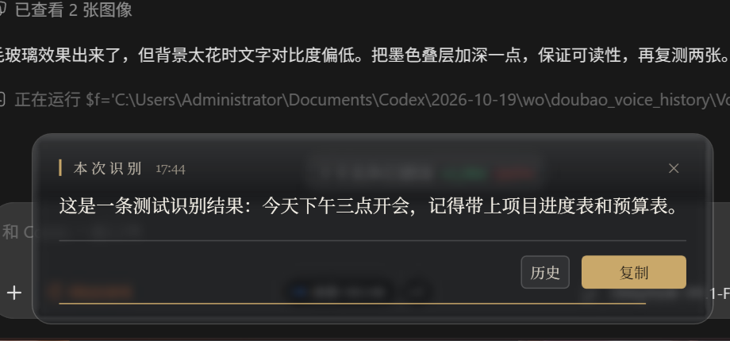
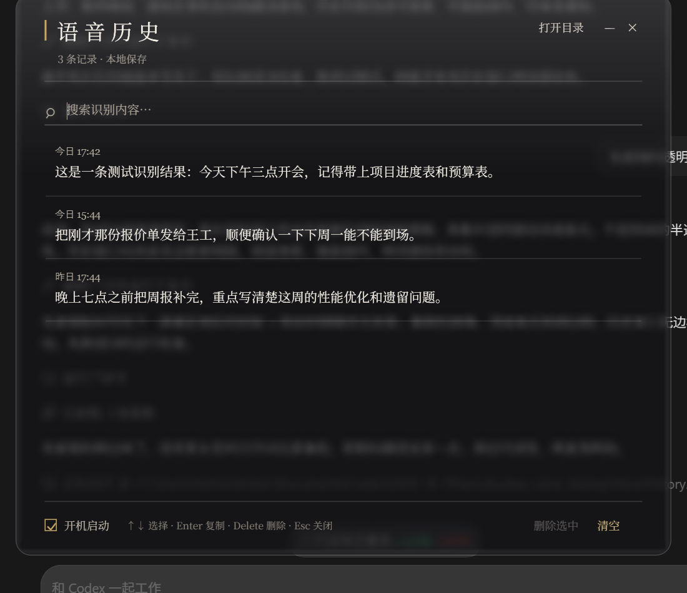

# 豆包语音历史 · Doubao Voice History

Windows 上的豆包输入法语音会话历史伴侣：毛玻璃浮条、点击复制、可搜索历史、版本监控与自检修复。

> 不是游戏外挂。程序只使用 Win32 窗口可见性与 Windows UI Automation 读取焦点输入框文本，不注入进程、不读写内存、不拦截网络。

## 功能

- 语音结束后在语音条上方显示毛玻璃浮条，点击即可复制
- 本地历史（最多 500 条），支持搜索、键盘操作、单条删除
- 安装器、Doctor 自检修复、卸载器
- 豆包版本监控：每 30 分钟检查一次，升级后托盘提醒
- 可选 IME 补丁：修复“按任意键打断录音”（仅豆包 0.9.2.7）
- GitHub Releases 自动打包与 SHA256 校验、应用内检查更新

## 安装

下载 Release 中的 `DoubaoVoiceHistory-Setup-v*.zip`，解压后双击 `一键安装.bat`。

安装位置：`%LOCALAPPDATA%\DoubaoVoiceHistory\app`  
数据位置：`%APPDATA%\DoubaoVoiceHistory`

## 界面





## 诊断与修复

托盘右键 → 诊断与修复，或运行：

```powershell
powershell -ExecutionPolicy Bypass -File "$env:LOCALAPPDATA\DoubaoVoiceHistory\app\Doctor.ps1" -Fix
```

报告输出到桌面，包含安装文件、进程、计划任务、历史、日志、豆包版本、窗口类、UIA、字体、截图、补丁状态。

## 版本监控

安装器创建 `DoubaoVoiceHistory-VersionWatch` 计划任务，每 30 分钟检查 `HKLM\SOFTWARE\DoubaoIme\VersionDir`。豆包升级后托盘会提示重新体检；补丁偏移只对 0.9.2.7 有效。

## 更新

托盘右键 → 检查更新。更新器读取 GitHub Releases，校验 `SHA256SUMS.txt` 后静默运行安装器。

## 发布

仓库已配置 GitHub Actions：

- 推送 `v*` 标签自动打包 `installer/` 并创建 Release
- 每次 push/PR 对所有 `.ps1` 做语法检查

发布步骤：

```powershell
.\Publish-GitHub.ps1
```

脚本会检查 `gh` 登录、创建公开仓库、推送并打 `v2.0.0` 标签。

## 许可

MIT
